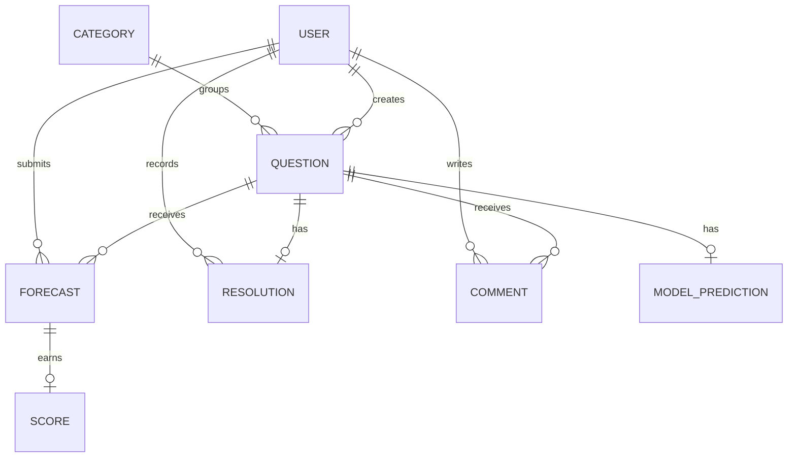

# Как устроен «Брайер»

## Что это

Веб-приложение для коллективного прогнозирования. Пользователь отвечает
на вопрос о будущем не «да» или «нет», а вероятностью от 1 до 99 %.
Когда исход известен, всем начисляются очки по правилу Брайера, а
калибровочная кривая показывает, насколько уверенность совпадает с
реальностью.

## Части проекта

```
браузер → Vite (React)
           └── /api/, /admin/, /static/admin/ → Django + DRF → PostgreSQL
```

- **frontend/** — React-приложение. Отвечает за страницы, навигацию и графики.
  Сессию, вопросы, рейтинг и статистику участника получает из API.
- **backend/** — Django. Хранит аккаунты и сессии, обслуживает админку.
  `GET /api/health/` проверяет, что PostgreSQL доступна.
  Миграции создают таблицы Django и приложения `forecasts`.
  В админке доступны категории и модерация вопросов.
- **Vite** пересылает запросы к API и админке на Django. Браузер видит один
  адрес, поэтому React и админка используют одну сессию.

## Модель данных



- **Пользователь** — встроенная модель Django. Хранит логин, имя, почту
  и права. Для блокировки используется `is_active`.
- **Категория** — название и уникальный код для фильтра ленты.
- **Вопрос** — автор, категория, заголовок, условия разрешения, статус,
  причина отклонения, время закрытия и необязательное ожидаемое время исхода.
- **Прогноз** — процент от 1 до 99. PostgreSQL разрешает одну запись
  на пару «пользователь — вопрос», при изменении обновляется та же запись.
- **Исход** — отдельная запись с ответом «да» или «нет», источником,
  администратором и датой. У вопроса может быть один исход.
- **Очки** — одна запись на прогноз после разрешения. Хранит счёт
  Брайера с четырьмя знаками после запятой и очки с двумя.
- **Комментарий** — вопрос, участник, текст и дата.
- **Прогноз модели** — вероятность от 0 до 1, версия модели и дата.
  У вопроса может быть один такой прогноз.

## Структура frontend

```
frontend/
  index.html          единственная HTML-страница, в ней <div id="root">
  vite.config.js      настройки сборщика Vite: React и Tailwind
  package.json        список библиотек и команды npm run dev / build
  src/
    main.jsx          точка входа: рисует приложение в #root
    App.jsx           текущий аккаунт и список адресов (маршрутов)
    api.js            запросы к Django и заголовок CSRF
    layouts/          рамки страниц: MainLayout (с навигацией), AuthLayout (вход)
    pages/            одна страница — один файл
    components/       блоки, из которых собираются страницы
    index.css         Tailwind, цвета дизайна, шрифт Onest
    fonts/            файлы шрифта Onest и его лицензия
    data/mock.js      данные для демонстрационных примеров интерфейса
    utils/score.js    формула очков Брайера и формат чисел
```

Почему так: одна HTML-страница, а переходы между «страницами» делает
React Router без перезагрузки — это и есть SPA (одностраничное приложение).

## Путь от клика до страницы

1. Пользователь нажимает ссылку, например карточку вопроса.
2. `<Link to="/questions/42">` меняет адрес в браузере без перезагрузки.
3. `BrowserRouter` в `App.jsx` находит маршрут `/questions/:id`.
4. Рисуется `MainLayout`, а на месте его `<Outlet />` — страница вопроса.
5. Страница берёт `id` из адреса и запрашивает `GET /api/questions/42/`.
   Django выбирает опубликованный вопрос из PostgreSQL.

## Как вопрос попадает в ленту

1. Участник отправляет форму на `POST /api/questions/`. Сервер берёт автора
   из сессии и создаёт вопрос со статусом «На модерации». Время формы указано по Москве.
2. Администратор в Django выбирает решение. При одобрении вопрос появляется в ленте.
   При отклонении администратор указывает причину.
3. Автор видит решение через `GET /api/questions/mine/`. Лента и публичная
   карточка доступны гостям только для опубликованных вопросов.
4. `GET /api/questions/` поддерживает поиск, фильтр по статусу и категории,
   сортировку по закрытию, новизне и числу прогнозов. Когда срок истёк, API
   показывает «Приём закрыт», даже если отдельная команда закрытия ещё не запускалась.
   Для вошедшего участника API добавляет его прогноз, а после дедлайна — прогноз модели, если он рассчитан.
   `GET /api/categories/` возвращает список категорий с числом открытых вопросов.

## Как сохраняется прогноз

1. Участник выбирает целое число от 1 до 99 и сохраняет его через
   `PUT /api/questions/42/forecast/`.
2. Django берёт пользователя из сессии. В транзакции сервер блокирует
   строку вопроса, проверяет статус и срок, затем создаёт или обновляет
   единственную запись участника по этому вопросу.
3. Карточка получает среднюю вероятность, число участников и десять
   диапазонов гистограммы. Положение своего прогноза видно только его автору.
4. Вкладка «Активные» в кабинете получает свои прогнозы по вопросам без
   исхода через `GET /api/forecasts/mine/active/`.

## Как начисляются очки

1. После срока закрытия администратор открывает вопрос и выбирает «Указать
   исход». Форма требует ответ «Да» или «Нет» и источник.
2. Django блокирует строку вопроса. В одной транзакции сервер сохраняет
   исход, создаёт по записи очков для каждого прогноза и меняет статус на
   «Разрешён». При сбое отменяются все три изменения.
3. Счёт Брайера равен квадрату разницы между вероятностью и исходом.
   Из него получаются очки: `100 × (1 − 2 × счёт Брайера)`. Для целых
   процентов точность очков составляет два знака после запятой.
4. Карточка показывает исход и источник всем, а очки — участнику, который
   их получил. Кабинет читает сохранённые очки через
   `GET /api/users/<username>/` вместе с калибровкой и статистикой.

## Рейтинг и калибровка

- `GET /api/rating/` группирует сохранённые очки по участникам. В рейтинг
  входят участники с 10 разрешёнными прогнозами. Места определяются
  по средним очкам. При равном среднем место общее.
- `GET /api/users/<username>/` показывает имя, статистику, калибровку и
  разрешённые прогнозы. Гости могут открыть профиль. Прогнозы по вопросам
  без исхода доступны только самому участнику в кабинете.
- Калибровка группирует прогнозы по диапазонам 1–10 %, 11–20 % и так далее.
  Для каждой непустой группы точка показывает среднюю обещанную вероятность
  и фактическую долю исходов «Да». Число прогнозов указано в таблице.

## Прогноз модели

- Логистическая регрессия оценивает вероятность исхода «Да». На вход
  поступают категория, срок приёма в днях, число участников, среднее
  и разброс прогнозов, прошлый средний Брайер участников.
- Признаки строятся по данным к дедлайну. История участника включает только
  исходы, известные к тому моменту. Если истории нет, используется Брайер 0,25.
- Команда закрытия выбирает модель, доступную на момент дедлайна, и
  сохраняет один прогноз в `ModelPrediction`. При разрешении действует
  та же проверка, если вопрос ещё не обработала команда закрытия.
  Переобучение сохраняет новую версию и оставляет старые прогнозы.
- Пока приём открыт, API скрывает прогноз модели. После исхода карточка
  сравнивает оценки по формуле Брайера. Модель, обученную на искусственных
  примерах, карточка явно помечает.

## Комментарии

- `GET /api/questions/42/comments/` отдаёт комментарии опубликованного
  вопроса от новых к старым. Курсор — ID последнего комментария на странице.
- `POST` добавляет комментарий от имени пользователя из сессии.
  Удалить свой комментарий можно из карточки, любой комментарий —
  через панель Django с соответствующим правом.

## Локальный режим защиты

`run-demo.sh` запускает PostgreSQL, Django, Vite и проверку дедлайнов
на ноутбуке. Демоданные и модели живут в отдельной папке `.demo-local`.
Первый запуск наполняет базу, последующие сохраняют состояние.

## Одна страница на три ширины

Макет нарисован для трёх ширин: телефон 390 px, планшет 834 px,
десктоп 1440 px. В коде это одна страница, которая перестраивается
классами Tailwind: без приставки — телефон, `md:` — от 768 px,
`lg:` — от 1024 px.

## Страницы

| Адрес | Файл | Что показывает |
|---|---|---|
| `/` | `pages/FeedPage.jsx` | лента вопросов, вкладки по статусу; гостю — приветствие |
| `/questions/:id` | `pages/QuestionPage.jsx` | вопрос: открыт, приём закрыт или исход известен |
| `/questions/new` | `pages/CreateQuestionPage.jsx` | форма нового вопроса |
| `/rating` | `pages/RatingPage.jsx` | рейтинг по средним очкам |
| `/users/:username` | `pages/ProfilePage.jsx` | профиль участника: числа, калибровка, разрешённые прогнозы |
| `/me`, `/me/resolved`, `/me/questions` | `pages/CabinetPage.jsx` | личный кабинет и его вкладки |
| `/login`, `/register` | `pages/LoginPage.jsx`, `pages/RegisterPage.jsx` | вход и регистрация |
| любой другой | `pages/NotFoundPage.jsx` | страница 404 |
| `/admin/` | — | админ-панель Django, не React |

## Роли

При открытии React запрашивает `GET /api/auth/session/`. Django читает
сессионную куку и возвращает аккаунт либо `null`. При регистрации или входе
Django проверяет форму и создаёт сессию. При выходе удаляет её.
POST-запросы передают заголовок `X-CSRFToken`, чтобы Django могла проверить
их происхождение. Роль для навигации приходит с сервера.
- **Гость** видит ленту, вопросы, рейтинг и профили; вместо формы
  прогноза — приглашение войти. Кабинет и создание вопроса переводят
  его на `/login`.
- **Участник** задаёт вопросы и сохраняет прогнозы. Активные прогнозы
  в кабинете берутся из базы, а во вкладке «Разрешённые» видны исходы и очки.
- **Администратор** — всё то же плюс ссылка «Админ-панель» на `/admin/`.

## Компоненты

Компоненты в `components/` — блоки, из которых собраны страницы.
Общие для многих страниц: `Button`, `Avatar`, `Status`, `Ruler`
(линейка вероятности), `SectionTitle`, `SidePanels` (панели боковой
колонки десктопа). Графики — свои компоненты на SVG: `Histogram`
и `CalibrationChart`.

## Данные локального показа

Отдельная база показа заполняется командой `seed_demo`. Вымышленные вопросы,
комментарии и прогнозы используют те же таблицы, что и данные, созданные
через сайт. Для закрытых вопросов с известным исходом команда вызывает
общий расчёт очков. Сайт читает эти результаты через обычный API.
